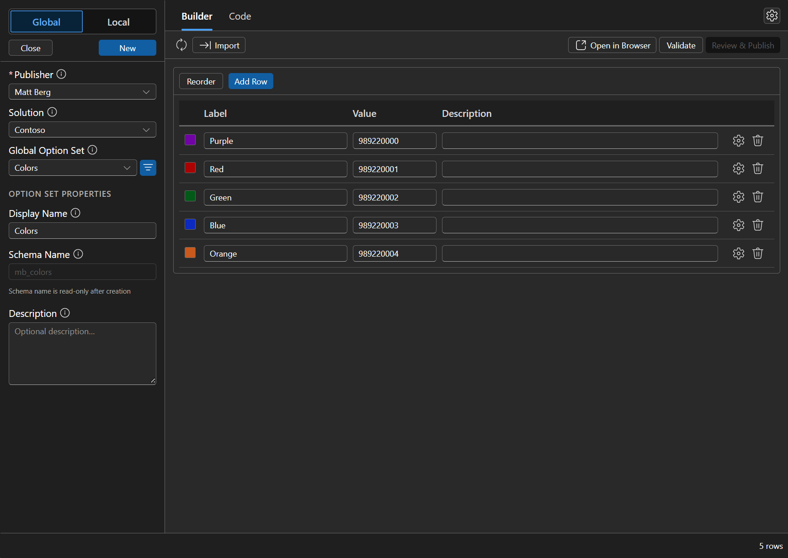
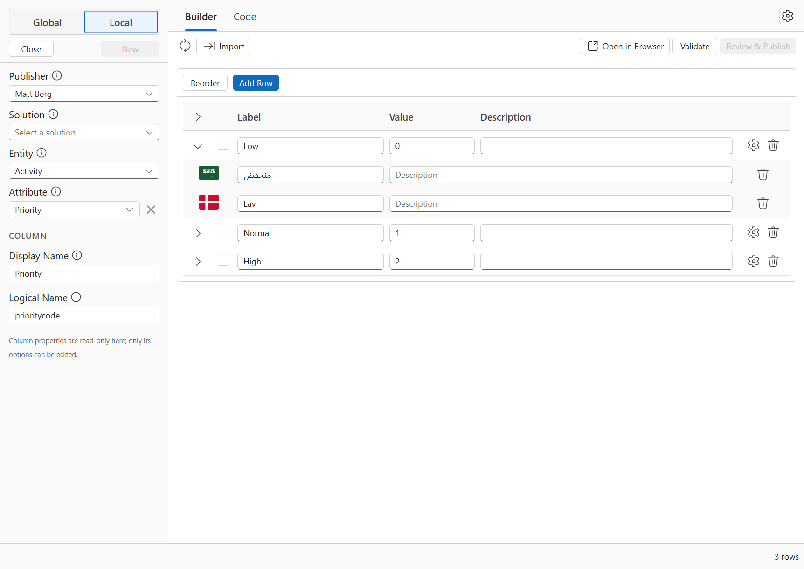

# OptionSet Manager

A [Power Platform ToolBox](https://powerplatformtoolbox.com) tool for creating and editing Dataverse choices (option sets), with multi-language support and a detailed review step before every save.





## Features

- **Global choices**: Create new ones in a solution, or load an existing one to edit.
- **Local choices**: Edit the options of an existing choice or multi-select choice column on any table, including Status and Status Reason. A column that uses a global choice opens read-only, with a button to edit it on the Global tab.
- **Multi-language support** Review and modify any configured localisation. Only the languages installed in your environment are offered.
- **All the options**: The ability to set the value, color, external value, and hidden flag. New values follow the publisher's option value prefix, and existing values can be changed.
- **Reorder** options by dragging or with Alt+Up/Down. The new order is saved with your other changes.
- **Review before saving**: See every insert, update, delete, and reorder before anything is sent, along with the environment and what will be published, with the chance to revert individual changes. Deleted options can be restored from the pending changes bar until you save.
- **Import** options from CSV or JSON, and **export** the current choice from the Code tab as JSON (all languages) or CSV (default language).

## Requirements

- [Power Platform ToolBox](https://powerplatformtoolbox.com) desktop app
- An active Dataverse connection
- System Customizer or System Administrator security role

## Usage

1. Choose **Global** or **Local** at the top of the sidebar.
2. Pick a **Publisher** and, optionally, a **Solution**.
3. For a global choice, pick one from **Global Option Set** to edit it, or click **New** to start one. For a local choice, pick the **Entity** (table) and **Attribute** (column).
4. Edit labels, values and descriptions, add or remove rows, and reorder them. Expand a row to edit its other languages.
5. Click **Validate**, then **Review & Publish**. Review the changes and confirm.

Settings (the gear icon) control language sub-rows, validation of blank translations, reordering and more.

## What this tool changes

Nothing is written to Dataverse until you click **Review & Publish** and confirm.

- **Global choices**: creates a new global choice and updates the display name and description of an existing one.
- **Options** of a global choice or a local choice column: inserts new options; updates labels, descriptions, color, external value and the hidden flag; deletes options; and changes their order. A global choice is shared, so its changes apply to everything that uses it.
- **Status Reason columns**: adds status reasons under a chosen Status, and updates, deletes and reorders them. A status reason stays in the Status it was created under.
- **Status columns**: Dataverse fixes these values for each table, so only their labels, descriptions and default status reason can change. Managed Status columns can't be changed.
- **Changed option values**: the option is created with the new value and the old one is deleted. Records are not updated: records that stored the old value, or a deleted option's value, keep that number, which no longer has a label.
- **Solutions**: a solution is optional. Dataverse puts every new global choice in the Default Solution; with an unmanaged solution selected, the new choice and any choice or column you change are added to that solution too. Status changes are the exception, because the Dataverse action takes no solution.
- **Saving**:  you are presented with a detailed review page to tell you exactly what is being changed.
- **Publishing**: uses the `PublishXmlRequest` to save the specific entity that is being modified. For a local choice, its table is published, which also publishes any other unpublished changes on that table even if they were done outside of this tool.
- **Files**: export writes a file only where you choose to save it.

It doesn't change records, tables, forms, views or security, or any column other than the options of the one you load.

**There is no undo.** Published changes and deletes can't be reverted from this tool. If you need a backup, export the solution from Dataverse or copy the JSON payload from the Code tab.

## Data and privacy

The tool talks only to your connected Dataverse environment, through the ToolBox APIs. It makes no other network calls and declares no CSP exceptions. **Open in Browser** opens make.powerapps.com in your browser.

## Development

```bash
pnpm install
pnpm dev-watch   # builds to dist/ with source maps, watches for changes
pnpm test        # unit tests
pnpm lint
```

In PPTB: **Debug → Load Local Tool** → select this project root → **Help → Toggle Tool DevTools**. There is no hot reload, so close and reload the tool tab after each rebuild.

## Building and publishing

```bash
pnpm build
pnpm validate
npm publish --access public
```

## AI Assistance

Much of the code was written with Claude Code and GitHub Copilot; I reviewed and tested it against Dataverse and maintain it.

## License

[GNU General Public License v3.0](LICENSE).
